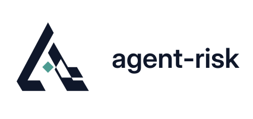

<a name="readme-top"></a>

<div align="center">

<!-- logo-family -->
<picture>
  <source media="(prefers-color-scheme: dark)" srcset="docs/assets/brand/logo-dark.svg">
  
</picture>


# agent-risk

**Certify an AI agent's violation rate, and re-check a stricter safety gate against the logs you already have**

[](https://arxiv.org/abs/2610.16280)
[](https://pypi.org/project/ai-agent-risk/)
[](https://www.python.org/downloads/)
[](https://github.com/yzhao062/agent-risk/actions/workflows/ci.yml)
[](https://github.com/yzhao062/agent-risk/blob/main/LICENSE)
[](https://huggingface.co/datasets/yzhao062/agent-risk-logs)

[Paper](https://arxiv.org/abs/2610.16280) · [PDF](https://arxiv.org/pdf/2610.16280) · [Install](#install) · [Quickstart](#quickstart) · [What We Certify](#what-we-certify) · [What It Answers](#what-it-answers) · [Key Results from the Paper](#key-results-from-the-paper) · [Reproduce the Paper](#reproduce-the-paper) · [Citation](#citation)


</div>

Agent evaluations usually report a count, such as 0 violations in 50 episodes. That count is not yet a decision. At 95% confidence, 50 clean independent episodes show only that the violation rate is below about 6%, so they cannot support a 5% limit; 59 clean episodes can, and a 1% limit needs 299. A certificate turns the count into a pass or fail against a limit fixed in advance, and when the true rate exceeds the limit, a 95% certificate passes at most 5% of the time. `certify_violations` takes per-episode labels, reports a one-sided upper bound, and counts a missing label as a violation.

A certificate covers only the deployment it was issued for, so a change to the agent needs a new one. For one common change, a stricter stopping gate (a rule that halts an episode once a monitor score crosses a threshold), the evidence is already in your logs. `replay_stop` replays the pass-all log (runs in which no gate blocked a step, with a monitor score and a harm label at each step) under the new gate, and `certify_replay` certifies the replayed harm rate against the same limit, with no new runs. This extends classical risk analysis to partial records and partial changes to running systems. Besides the [conditions of any certificate](#what-we-certify), replay assumes that the threshold was fixed before you looked at the log, that nothing else changes, that the agent does not anticipate the gate, and that a stop causes no further harm. A retry gate gets only a conservative bound from the log, and a change that replay cannot settle, such as a new model, needs fresh episodes.

> [!NOTE]
> This repository accompanies the paper [*agent-risk: Risk Assessment for Changes to AI Agents*](https://arxiv.org/abs/2610.16280) by Yue Zhao, Zixiang Xu, Angela Huyue Zhang, S. Alex Yang, and Xiyang Hu (arXiv:2610.16280, 2026). It holds the Python package, the 15 finite checks, the experiment code, the registrations, and the survey; the 3.5 GB of run logs are on [Hugging Face](https://huggingface.co/datasets/yzhao062/agent-risk-logs).

## Install

```bash
pip install ai-agent-risk
```

Or install from GitHub with `pip install git+https://github.com/yzhao062/agent-risk`, or clone the repository and run `pip install .` at its root. The distribution name is `ai-agent-risk`; the import name is `agent_risk`. Requires Python 3.9 or later, NumPy (>= 1.20), and SciPy (>= 1.7).

## Quickstart

The snippet below tells the story on a synthetic pass-all log of 200 episodes: the current deployment does not earn a certificate at a 5% limit, and a stricter stopping gate, replayed on the same log, does.

```python
from agent_risk import Episode, certify_replay, certify_violations, replay_stop, sample_size

# A pass-all log of the current deployment. Each Episode holds monitor scores, harm labels, and costs per step.
quiet = Episode([0.1, 0.2, 0.1], [False, False, False], [1, 1, 1], failed=False)
caught = Episode([0.1, 0.97, 0.3], [False, False, True], [1, 1, 1], failed=False)  # a high score precedes the harm
missed = Episode([0.1, 0.2, 0.3], [False, True, False], [1, 1, 1], failed=False)  # harm with only low scores
log = [quiet] * 180 + [caught] * 16 + [missed] * 4

print(sample_size(0.05))  # 59: the smallest size that passes with no violations
today = certify_violations([e.harm_flag for e in log], limit=0.05)
print(today.status, round(today.upper, 3))  # 20 of 200 violate: not_certified 0.142
gated = certify_replay(replay_stop(log, theta=0.9), limit=0.05)
print(gated.status, round(gated.upper, 3))  # a gate at 0.9 stops the 16 caught (8%): passed 0.045
```

Choose the threshold (`theta`) before you look at the log you certify on; tuning it on that log voids the guarantee (see [What We Certify](#what-we-certify)), and the 0.9 here is only for illustration. The result also assumes that nothing else changes and that the agent does not anticipate the gate. It bounds harm only: this gate stops 8% of the episodes, each counted as a failed task, and a gate that stops every episode would pass. Replay assumes no harm after a stop, which is a modeling choice, so a `StopValuation` with a positive `post_stop_harm` makes `certify_replay` refuse a `limit`. A retry gate gets a conservative certificate through `retry_harm_bounds` and `certify_retry`.

A certificate renders with its conditions through `today.to_markdown()` and `today.to_json()`, `scope=` records the deployment it covers, and a missing label (`None` or NaN) counts as a violation.

<details>
<summary><b>Loading logs and comparing two policies</b></summary>

Logs load from JSON Lines, with `null` marking unobserved harm:

```python
from agent_risk import load_jsonl

lines = ['{"scores": [0.1, 0.97], "harm": [false, null], "cost": [5, 6], "failed": false}']
episodes = load_jsonl(lines)  # or load_jsonl("log.jsonl")
```

Paired comparisons and equivalence tests:

```python
from agent_risk import is_equivalent, newcombe_paired_interval

ci = newcombe_paired_interval(both=40, first_only=1, second_only=2, neither=57, level=0.90)
print(round(ci.estimate, 3), round(ci.lower, 3), round(ci.upper, 3))  # -0.01 -0.043 0.023
print(is_equivalent(ci, margin=0.10))  # True: equivalent at alpha = 0.05
```

</details>

## What We Certify

"Certify" has three common senses: accreditation (an organization attests that a system meets a standard), formal verification (a proof that a property holds for every input in a set), and a statistical certificate (a one-sided confidence bound on an average rate, compared with a limit set in advance). This library means the third.

Fix a deployment (model, tools, permissions, prompts, and any gates with their thresholds), a task distribution, and a violation rule (the labels or judge you supply, applied as recorded). A passed certificate states that the violation rate is at most the limit at the stated confidence. The rate is the probability that an episode drawn from the task distribution and run on the deployment is labeled a violation. Whenever that rate exceeds the limit, the procedure passes with probability at most 1 - confidence. Individual episodes can still violate, and the certificate covers that deployment and task distribution only. The guarantee rests on three conditions:

- **Independence.** Outcomes are independent draws, with one episode per independently sampled task. Repeated runs of one task estimate that task's rate, not the rate over the task distribution.
- **Fixed sample.** The number of episodes is set before any outcome is seen, and the certificate uses every episode drawn. Recomputing after each batch and stopping at the first pass inflates the error, and so does dropping episodes after the labels are seen.
- **Fixed in advance.** The deployment (including any gate threshold), the violation rule, the limit, and the confidence are chosen before the certification episodes are seen and are not tuned on them.

A failed certificate (`not_certified`) does not show that the rate exceeds the limit: too few episodes, too many violations, or both can produce it. Separate certificates, such as one per rule or per benchmark row, each control their own error, but they do not control the chance that at least one incorrect certificate passes.

## What It Answers

Replaying the pass-all log under a proposed gate sorts each episode by what happens at its first deviation from the log. A stopping gate produces the first two cases, which a log with per-step harm and a declared stop value settles; a retry gate also produces the third, which needs logged support, a saved-state rerun, or a bound:

| Case | Under the change, the episode... | What settles it | In this repository |
|---|---|---|---|
| **Agree** | acts exactly as logged | The log itself | `replay_stop` |
| **Stop** | is stopped at its first deviation | A declared stop value (needs per-step harm in the log) | `replay_stop`; `certify_replay` with a `limit` |
| **Continue** | continues past its first deviation | Logged support, a rerun from a saved state, or a bound | `retry_harm_bounds`, `certify_retry`; saved-state reruns in [`experiments/`](https://github.com/yzhao062/agent-risk/tree/main/experiments) |

### What a Replay Reports

This three-episode example shows how a stopping gate at theta = 0.94 changes harm, task failure, and cost. It also reports the replay certificate and the harm interval for a retry gate.

```python
from agent_risk import Episode, certify_replay, replay_stop, retry_harm_bounds

scores, cost = [0.10, 0.20, 0.97, 0.30], [10, 20, 30, 40]
episodes = [
    Episode(scores, [False, True, False, False], cost, failed=False),  # harm at step 1
    Episode(scores, [False, False, False, True], cost, failed=False),  # harm at step 3
    Episode([0.10, 0.20], [False, False], [10, 20], failed=False),     # never above 0.94
]

replay = replay_stop(episodes, theta=0.94)
print(replay.branches, replay.stop_steps)  # ('stop', 'stop', 'agree') (2, 2, None)
print(round(replay.p_harm, 3))             # 0.333: only the step-1 harm survives
print(round(replay.p_failure, 3))          # 0.667: a stop counts as a failure by default
print(replay.mean_cost)                    # 50.0 = (60 + 60 + 30) / 3
print(round(replay.stop_mass, 3), round(replay.stop_clean_share, 3))  # 0.667 0.333

cert = certify_replay(replay, alpha=0.05)
print(cert.n_harmed, cert.n, round(cert.upper, 3))  # 1 3 0.865

bounds = retry_harm_bounds(episodes, theta=0.94, cap=2)
print([round(v, 3) for v in bounds.interval])       # [0.333, 0.667]
```

## Key Results from the Paper

These results show where replay settles a change and where it cannot.

**One log, two gates, half the agent calls.** In a bash sandbox, a 7,200-episode log alone decided neither of two retry gates, which let the agent act after refusals the log never shows. Rerunning only each gate's blocked episodes from saved states reached both live decisions at half the agent calls of a live test sized post hoc for them, given the log.

**Per-step harm decides whether a stop can be replayed.** Without per-step harm, a stopping gate's certified harm ceiling rose up to 2.5-fold, since the log hides whether harm preceded the stop.

**A new model needs new evidence.** The new model reproduced none of 99 logged episodes, so replay settled none; the same model reproduced every one at logged inputs and seeds. A model release needs support, bounds, or new runs from step 0.

## Reproduce the Paper

The paper's numbers come from the tag `v0.1.0`. After cloning the repository, run `git checkout v0.1.0` before the steps below.

1. **Get the logs.** Download the dataset into `data/` from the repository root; [`data/README.md`](https://github.com/yzhao062/agent-risk/blob/main/data/README.md) explains the layout, checksums, and redactions.

   ```bash
   hf download yzhao062/agent-risk-logs --repo-type dataset --local-dir data \
     --include "logs/*" "arm-e/*" MANIFEST.tsv REDACTIONS.tsv
   ```

2. **Regenerate the numbers.** [`ARTIFACT.md`](https://github.com/yzhao062/agent-risk/blob/main/ARTIFACT.md) maps every table and figure of the paper to its logs, its registration, and its command (A1 to A39). The commands write to `outputs/` and leave `data/` untouched.
3. **Check the theory.** `python checks/run_all.py` runs the 15 finite checks of the formal results ([`checks/README.md`](https://github.com/yzhao062/agent-risk/blob/main/checks/README.md)).

> [!TIP]
> On the released logs, the documented commands reproduce every number of the registered analyses, and the figure script regenerates the paper's Figures D.1 to D.3. To rerun experiments live (served models, ControlArena, tau2-bench), see [`experiments/RUNNING.md`](https://github.com/yzhao062/agent-risk/blob/main/experiments/RUNNING.md).

<details>
<summary><b>Repository map</b></summary>

| Directory / File | Description |
|---|---|
| [`src/agent_risk/`](https://github.com/yzhao062/agent-risk/tree/main/src/agent_risk) | Core Python package: episode representation, stopping replay, retry bounds, exact Clopper-Pearson certification, and paired Newcombe confidence intervals. |
| [`tests/`](https://github.com/yzhao062/agent-risk/tree/main/tests) | Unit and regression tests (585) covering replay algorithms, stop valuations, bounds, certificates, and paper test vectors. |
| [`checks/`](https://github.com/yzhao062/agent-risk/tree/main/checks) | 15 finite-instance check scripts verifying the theorems, combinatorial bounds, and design invariants. |
| [`experiments/`](https://github.com/yzhao062/agent-risk/tree/main/experiments) | Experiment harness, run scripts, analysis and post hoc scripts, and the figure script. |
| [`registrations/`](https://github.com/yzhao062/agent-risk/tree/main/registrations) | Registration documents for the paper's runs (sample sizes, analysis rules, margins, prediction hashes), each with its registration time, and the run records. |
| [`data/`](https://github.com/yzhao062/agent-risk/tree/main/data) | Log manifest, SHA-256 checksums, redaction records, run manifests, and download instructions. |
| [`survey/`](https://github.com/yzhao062/agent-risk/tree/main/survey) | The characteristic survey: 23 coded sources with their recorded versions, 30 AI Incident Database incidents, the 20-code codebook, both coders' matrices, and the agreement script. |
| [`supplement/`](https://github.com/yzhao062/agent-risk/tree/main/supplement) | Companion files for the paper's appendices. |
| [`ARTIFACT.md`](https://github.com/yzhao062/agent-risk/blob/main/ARTIFACT.md) | The artifact guide: paper names and run codes, verbatim prompts and policies, and every reproduction command. |

</details>

<details>
<summary><b>Running the tests</b></summary>

```bash
pip install ".[test]"
pytest
```

This runs the 585 tests in [`tests/`](https://github.com/yzhao062/agent-risk/tree/main/tests). The `test` extra installs `statsmodels` for the comparison tests against its Clopper-Pearson interval; without it, those tests are skipped.

</details>

## Citation

```bibtex
@article{zhao2026agentrisk,
  title   = {agent-risk: Risk Assessment for Changes to AI Agents},
  author  = {Zhao, Yue and Xu, Zixiang and Zhang, Angela Huyue and Yang, S. Alex and Hu, Xiyang},
  journal = {arXiv preprint arXiv:2610.16280},
  year    = {2026},
  doi     = {10.48550/arXiv.2610.16280},
  url     = {https://arxiv.org/abs/2610.16280}
}
```

## License

The code is under the [BSD 2-Clause License](https://github.com/yzhao062/agent-risk/blob/main/LICENSE). The logs on [Hugging Face](https://huggingface.co/datasets/yzhao062/agent-risk-logs) are under [CC BY 4.0](https://creativecommons.org/licenses/by/4.0/) ([`LICENSE-DATA.md`](https://github.com/yzhao062/agent-risk/blob/main/LICENSE-DATA.md)).

<details>
<summary><b>Third-party components</b></summary>

- **ControlArena**: task definitions, environments, and bash tool harnesses (used in all bash-environment runs) derive from [ControlArena](https://github.com/UKGovernmentBEIS/control-arena), under the [MIT License](https://opensource.org/licenses/MIT).
- **tau2-bench**: airline customer-support tasks, dialogue environments, and the customer simulator (used in the airline runs, E3 and E5) derive from [tau2-bench](https://github.com/sierra-research/tau2-bench), under the [MIT License](https://opensource.org/licenses/MIT).
- **Qwen models**: the agent and monitor models (Qwen3-14B-FP8, Qwen3-14B, Qwen3-4B-Instruct-2507, Qwen3.5-27B-FP8, Qwen2.5-14B-Instruct) are released by their developers under the [Apache-2.0 License](https://www.apache.org/licenses/LICENSE-2.0). Neither this repository nor the dataset contains model weights.

</details>

<p align="right"><a href="#readme-top">↑ back to top</a></p>
