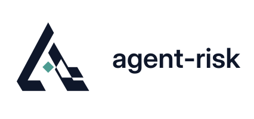

<a name="readme-top"></a>

<div align="center">

<!-- logo-family -->
<picture>
  <source media="(prefers-color-scheme: dark)" srcset="docs/assets/brand/logo-dark.svg">
  
</picture>


# agent-risk

**Risk assessment for changes to AI agents, starting from the logs you already have**

[](https://arxiv.org/abs/2610.16280)
[](https://pypi.org/project/ai-agent-risk/)
[](https://www.python.org/downloads/)
[](https://github.com/yzhao062/agent-risk/actions/workflows/ci.yml)
[](https://github.com/yzhao062/agent-risk/blob/main/LICENSE)
[](https://huggingface.co/datasets/yzhao062/agent-risk-logs)

[Paper](https://arxiv.org/abs/2610.16280) · [PDF](https://arxiv.org/pdf/2610.16280) · [What It Answers](#what-it-answers) · [Key Results](#key-results) · [Install](#install) · [Quickstart](#quickstart) · [Reproduce the Paper](#reproduce-the-paper) · [Citation](#citation)


</div>

Before changing a deployed AI agent (a stricter safety gate, a new model), organizations must approve the change, starting from existing logs. `agent-risk` extends classical risk analysis to partial records and partial changes to running systems: it replays logged episodes under the proposed change, assuming nothing else changes and the agent does not anticipate the change. The log settles episodes that act as before, a declared stop value settles stopped ones, and the rest need logged support, a saved-state rerun, or a bound.

> [!NOTE]
> This repository accompanies the paper [*agent-risk: Risk Assessment for Changes to AI Agents*](https://arxiv.org/abs/2610.16280) by Yue Zhao, Zixiang Xu, Angela Huyue Zhang, S. Alex Yang, and Xiyang Hu (arXiv:2610.16280, 2026). It holds the Python package, the 15 finite checks, the experiment code, the registrations, and the survey; the 3.5 GB of run logs are on [Hugging Face](https://huggingface.co/datasets/yzhao062/agent-risk-logs).

## What It Answers

Replay a proposed change over each logged episode and sort the episode by what happens at its first deviation from the log:

| Case | Under the change, the episode... | What settles it | In this repository |
|---|---|---|---|
| **Agree** | acts exactly as logged | The log itself | `replay_stop` |
| **Stop** | is stopped at its first deviation | A declared stop value (needs per-step harm in the log) | `replay_stop`, `certify_replay` |
| **Continue** | continues past its first deviation | Logged support, a rerun from a saved state, or a bound | `retry_harm_bounds`; saved-state reruns in [`experiments/`](https://github.com/yzhao062/agent-risk/tree/main/experiments) |

## Key Results

**One log, two gates, half the agent calls.** In a bash sandbox, a 7,200-episode log alone decided neither of two retry gates, which let the agent act after refusals the log never shows. Rerunning only each gate's blocked episodes from saved states reached both live decisions at half the agent calls of a live test sized post hoc for them, given the log.

**Per-step harm decides whether a stop can be replayed.** Without per-step harm, a stopping gate's certified harm ceiling rose up to 2.5-fold, since the log hides whether harm preceded the stop.

**A new model needs new evidence.** The new model reproduced none of 99 logged episodes, so replay settled none; the same model reproduced every one at logged inputs and seeds. A model release needs support, bounds, or new runs from step 0.

## Install

```bash
pip install ai-agent-risk
```

Or install from GitHub with `pip install git+https://github.com/yzhao062/agent-risk`, or clone the repository and run `pip install .` at its root. The distribution name is `ai-agent-risk`; the import name is `agent_risk`. Requires Python 3.9 or later, NumPy (>= 1.20), and SciPy (>= 1.7).

## Quickstart

The snippet below replays three episodes under a stopping gate (theta = 0.94), computes replayed harm, failure, and cost, certifies an exact Clopper-Pearson upper bound on harm, and bounds harm under a retry gate:

```python
from agent_risk import Episode, certify_replay, replay_stop, retry_harm_bounds

scores, cost = [0.10, 0.20, 0.97, 0.30], [10, 20, 30, 40]
episodes = [
    Episode(scores, [False, True, False, False], cost, failed=False),  # harm at step 1
    Episode(scores, [False, False, False, True], cost, failed=False),  # harm at step 3
    Episode([0.10, 0.20], [False, False], [10, 20], failed=False),     # never above 0.94
]

replay = replay_stop(episodes, theta=0.94)
print(replay.branches, replay.stop_steps)  # ('stop', 'stop', 'agree') (2, 2, None)
print(round(replay.p_harm, 3))             # 0.333: only the step-1 harm survives
print(round(replay.p_failure, 3))          # 0.667: a stop counts as a failure by default
print(replay.mean_cost)                    # 50.0 = (60 + 60 + 30) / 3
print(round(replay.stop_mass, 3), round(replay.stop_clean_share, 3))  # 0.667 0.333

cert = certify_replay(replay, alpha=0.05)
print(cert.n_harmed, cert.n, round(cert.upper, 3))  # 1 3 0.865

bounds = retry_harm_bounds(episodes, theta=0.94, cap=2)
print([round(v, 3) for v in bounds.interval])       # [0.333, 0.667]
```

<details>
<summary><b>Loading logs and comparing two policies</b></summary>

Logs load from JSON Lines, with `null` marking unobserved harm:

```python
from agent_risk import load_jsonl

lines = ['{"scores": [0.1, 0.97], "harm": [false, null], "cost": [5, 6], "failed": false}']
episodes = load_jsonl(lines)  # or load_jsonl("log.jsonl")
```

Paired comparisons and equivalence tests:

```python
from agent_risk import is_equivalent, newcombe_paired_interval

ci = newcombe_paired_interval(both=40, first_only=1, second_only=2, neither=57, level=0.90)
print(round(ci.estimate, 3), round(ci.lower, 3), round(ci.upper, 3))  # -0.01 -0.043 0.023
print(is_equivalent(ci, margin=0.10))  # True: equivalent at alpha = 0.05
```

</details>

## Reproduce the Paper

1. **Get the logs.** Download the dataset into `data/` from the repository root; [`data/README.md`](https://github.com/yzhao062/agent-risk/blob/main/data/README.md) explains the layout, checksums, and redactions.

   ```bash
   hf download yzhao062/agent-risk-logs --repo-type dataset --local-dir data \
     --include "logs/*" "arm-e/*" MANIFEST.tsv REDACTIONS.tsv
   ```

2. **Regenerate the numbers.** [`ARTIFACT.md`](https://github.com/yzhao062/agent-risk/blob/main/ARTIFACT.md) maps every table and figure of the paper to its logs, its registration, and its command (A1 to A39). The commands write to `outputs/` and leave `data/` untouched.
3. **Check the theory.** `python checks/run_all.py` runs the 15 finite checks of the formal results ([`checks/README.md`](https://github.com/yzhao062/agent-risk/blob/main/checks/README.md)).

> [!TIP]
> On the released logs, the documented commands reproduce every number of the registered analyses, and the figure script regenerates the paper's Figures D.1 to D.3. To rerun experiments live (served models, ControlArena, tau2-bench), see [`experiments/RUNNING.md`](https://github.com/yzhao062/agent-risk/blob/main/experiments/RUNNING.md).

<details>
<summary><b>Repository map</b></summary>

| Directory / File | Description |
|---|---|
| [`src/agent_risk/`](https://github.com/yzhao062/agent-risk/tree/main/src/agent_risk) | Core Python package: episode representation, stopping replay, retry bounds, exact Clopper-Pearson certification, and paired Newcombe confidence intervals. |
| [`tests/`](https://github.com/yzhao062/agent-risk/tree/main/tests) | Unit and regression tests (149) covering replay algorithms, stop valuations, bounds, and paper test vectors. |
| [`checks/`](https://github.com/yzhao062/agent-risk/tree/main/checks) | 15 finite-instance check scripts verifying the theorems, combinatorial bounds, and design invariants. |
| [`experiments/`](https://github.com/yzhao062/agent-risk/tree/main/experiments) | Experiment harness, run scripts, analysis and post hoc scripts, and the figure script. |
| [`registrations/`](https://github.com/yzhao062/agent-risk/tree/main/registrations) | Registration documents for the paper's runs (sample sizes, analysis rules, margins, prediction hashes), each with its registration time, and the run records. |
| [`data/`](https://github.com/yzhao062/agent-risk/tree/main/data) | Log manifest, SHA-256 checksums, redaction records, run manifests, and download instructions. |
| [`survey/`](https://github.com/yzhao062/agent-risk/tree/main/survey) | The characteristic survey: 23 coded sources with their recorded versions, 30 AI Incident Database incidents, the 20-code codebook, both coders' matrices, and the agreement script. |
| [`supplement/`](https://github.com/yzhao062/agent-risk/tree/main/supplement) | Companion files for the paper's appendices. |
| [`ARTIFACT.md`](https://github.com/yzhao062/agent-risk/blob/main/ARTIFACT.md) | The artifact guide: paper names and run codes, verbatim prompts and policies, and every reproduction command. |

</details>

<details>
<summary><b>Running the tests</b></summary>

```bash
pip install ".[test]"
pytest
```

This runs the 149 tests in [`tests/`](https://github.com/yzhao062/agent-risk/tree/main/tests). Without the optional `statsmodels`, two comparison tests are skipped (147 passed, 2 skipped).

</details>

## Citation

```bibtex
@article{zhao2026agentrisk,
  title   = {agent-risk: Risk Assessment for Changes to AI Agents},
  author  = {Zhao, Yue and Xu, Zixiang and Zhang, Angela Huyue and Yang, S. Alex and Hu, Xiyang},
  journal = {arXiv preprint arXiv:2610.16280},
  year    = {2026},
  doi     = {10.48550/arXiv.2610.16280},
  url     = {https://arxiv.org/abs/2610.16280}
}
```

## License

The code is under the [BSD 2-Clause License](https://github.com/yzhao062/agent-risk/blob/main/LICENSE). The logs on [Hugging Face](https://huggingface.co/datasets/yzhao062/agent-risk-logs) are under [CC BY 4.0](https://creativecommons.org/licenses/by/4.0/) ([`LICENSE-DATA.md`](https://github.com/yzhao062/agent-risk/blob/main/LICENSE-DATA.md)).

<details>
<summary><b>Third-party components</b></summary>

- **ControlArena**: task definitions, environments, and bash tool harnesses (used in all bash-environment runs) derive from [ControlArena](https://github.com/UKGovernmentBEIS/control-arena), under the [MIT License](https://opensource.org/licenses/MIT).
- **tau2-bench**: airline customer-support tasks, dialogue environments, and the customer simulator (used in the airline runs, E3 and E5) derive from [tau2-bench](https://github.com/sierra-research/tau2-bench), under the [MIT License](https://opensource.org/licenses/MIT).
- **Qwen models**: the agent and monitor models (Qwen3-14B-FP8, Qwen3-14B, Qwen3-4B-Instruct-2507, Qwen3.5-27B-FP8, Qwen2.5-14B-Instruct) are released by their developers under the [Apache-2.0 License](https://www.apache.org/licenses/LICENSE-2.0). Neither this repository nor the dataset contains model weights.

</details>

<p align="right"><a href="#readme-top">↑ back to top</a></p>
