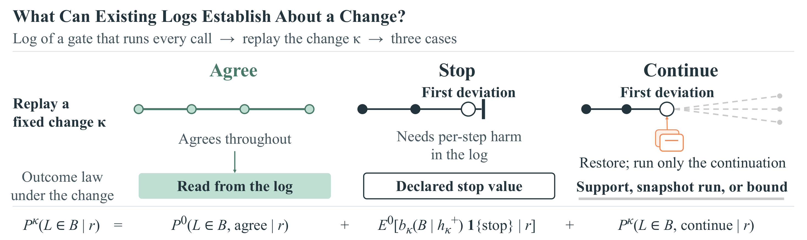

<a name="readme-top"></a>

<div align="center">

<!-- logo-family -->
<picture>
  <source media="(prefers-color-scheme: dark)" srcset="https://raw.githubusercontent.com/yzhao062/agent-risk/main/docs/assets/brand/logo-dark.svg">
  
</picture>

# agent-risk

**Certify an AI agent's violation rate, and re-check a stricter safety gate against the logs you already have**

[](https://arxiv.org/abs/2610.16280)
[](https://pypi.org/project/ai-agent-risk/)
[](https://www.python.org/downloads/)
[](https://github.com/yzhao062/agent-risk/actions/workflows/ci.yml)
[](https://github.com/yzhao062/agent-risk/blob/main/LICENSE)
[](https://huggingface.co/datasets/yzhao062/agent-risk-logs)

[Paper](https://arxiv.org/abs/2610.16280) · [PDF](https://arxiv.org/pdf/2610.16280) · [What You Can Do](#1-what-you-can-do) · [Install](#2-install) · [Reference](#3-reference) · [Key Results](#4-key-results-from-the-paper) · [Reproduce](#5-reproduce-the-paper) · [Citation](#6-citation) · [License](#7-license)

</div>

```python
# pip install ai-agent-risk
from agent_risk import certify_violations, sample_size

cert = certify_violations([0] * 50, limit=0.05)  # 50 episodes, no violations
print(cert.status, round(cert.upper, 3))  # not_certified 0.058

print(sample_size(0.05))  # 59
```

Agent evaluations often end in a count, such as 0 violations in 50 episodes. At 95% confidence, those 50 episodes show only that the violation rate is below about 6%, so they cannot support a 5% limit; 59 clean episodes can. A *certificate* turns the count into a pass or fail against a limit fixed in advance. It is a statistical statement, neither an accreditation nor a formal proof. When you already have a log, a stricter safety gate can be re-checked on it with no new runs (1.2).

| What do you want to know? | Call | Input | Section |
|---|---|---|---|
| Is my agent's violation rate below a limit, and how many episodes do I need? | `certify_violations`, `sample_size` | one 0/1 label per episode | [1.1](#11-certify-a-deployment) |
| Does a stricter stopping gate pass, using logs I already have? | `replay_stop`, `certify_replay` | per-step records | [1.2](#12-re-check-a-stricter-stopping-gate) |
| What can the log say about a gate that allows a retry after a block? | `retry_harm_bounds`, `certify_retry` | per-step records | [1.3](#13-bound-a-retry-gate) |
| Is the new version within a margin of the old one on the same tasks? | `newcombe_paired_interval`, `is_equivalent` | paired counts | [1.4](#14-compare-two-policies-on-the-same-tasks) |
| How do I get my logs in? | `Episode`, `load_jsonl` | JSON Lines or dicts | [1.5](#15-load-your-logs) |

> [!NOTE]
> This repository accompanies the paper [*agent-risk: Risk Assessment for Changes to AI Agents*](https://arxiv.org/abs/2610.16280) by Yue Zhao, Zixiang Xu, Angela Huyue Zhang, S. Alex Yang, and Xiyang Hu (arXiv:2610.16280, 2026). It holds the Python package, the 15 finite checks, the experiment code, the registrations, and the survey; the 3.5 GB of run logs are on [Hugging Face](https://huggingface.co/datasets/yzhao062/agent-risk-logs).

## 1. What You Can Do

### 1.1 Certify a Deployment

**Is my agent's violation rate below a limit, and how many episodes do I need?** Use this before a launch or for a safety case, once a rule or judge labels each episode as a violation or not.

```python
from agent_risk import certify_violations

labels = [0] * 59  # one label per episode: 1 is a violation, None is missing
cert = certify_violations(labels, limit=0.05, scope={"agent": "demo"})

print(cert.status, round(cert.upper, 4))  # passed 0.0495
report = cert.to_markdown()  # renders as shown below
```

> **Status:** passed
>
> The upper bound 0.04951 is at most the limit 0.05 at 95% one-sided confidence.
>
> - Episodes: 59
> - Violations counted: 0 (estimate 0)
> - Unknown outcomes: 0
> - Method: one-sided exact Clopper-Pearson
> - Scope: `{"agent":"demo"}`
>
> The bound assumes that the episodes are independent draws from the task distribution, that their number was fixed before any outcome was seen and every drawn episode is counted, and that the deployment, the violation rule, the limit, and the confidence were chosen before the certification episodes were seen.
>
> Separate certificates each control their own error, but they do not control the chance that at least one incorrect certificate passes.

<details>
<summary><b>What the certificate assumes</b></summary>

When the true rate exceeds the limit, a 95% certificate passes at most 5% of the time. `sample_size(limit)` gives the smallest number of episodes that passes with no violations (59 for a 5% limit and 299 for 1%), and `max_violations=` sizes the sample for a tolerated count. Individual episodes can still violate, and a change to the agent needs a new certificate. The printed conditions mean three things in practice:

- **Independence.** Draw one episode per independently sampled task. Repeated runs of one task estimate that task's rate, not the rate over the task distribution.
- **Fixed sample.** Set the number of episodes before any outcome is seen, and count every drawn episode. Recomputing after each batch and stopping at the first pass inflates the error, and so does dropping episodes after the labels are seen.
- **Fixed in advance.** Choose the deployment, the violation rule, the limit, and the confidence before the certification episodes are seen, and do not tune them on those episodes.

A failed certificate (`not_certified`) does not show that the rate exceeds the limit: too few episodes, too many violations, or both can produce it. A missing label (`None` or NaN) counts as a violation and is reported in `n_unknown`. `scope=` records the deployment the certificate covers, `to_json()` stores the certificate with it, and `Certificate.from_json` rebuilds the certificate and recomputes the bound from the counts.

</details>

### 1.2 Re-Check a Stricter Stopping Gate

**Does the agent pass if I halt an episode once a monitor score crosses a threshold?** Use this when a monitor already scores your agent's steps, a stricter threshold is on the table, and you want the answer from the pass-all log you already have (runs in which no gate blocked a step), with no new runs.

```python
from agent_risk import Episode, certify_replay, certify_violations, replay_stop

# Episode(monitor score per step, harm per step, cost per step, failed)
quiet = Episode([0.1, 0.2, 0.1], [0, 0, 0], [1, 1, 1], failed=False)
caught = Episode([0.1, 0.97, 0.3], [0, 0, 1], [1, 1, 1], failed=False)  # high score, then harm
missed = Episode([0.1, 0.2, 0.3], [0, 1, 0], [1, 1, 1], failed=False)  # harm, no high score
log = [quiet] * 180 + [caught] * 16 + [missed] * 4  # 200 logged episodes

replay = replay_stop(log, theta=0.9)  # stop once a score exceeds 0.9
before = certify_violations([e.harm_flag for e in log], limit=0.05)
after = certify_replay(replay, limit=0.05)

print(before.status, after.status)  # not_certified passed
print(replay.p_harm, replay.p_failure)  # 0.02 0.08
```

The gate stops the 16 caught episodes before their harm, so the harm rate falls from 10% to 2% and the gate passes, at the price of failing the 8% of tasks it stops. The certificate holds only if `theta` was fixed before you looked at the log you certify on, and it bounds harm only, so report task failure next to it.

<p align="center"></p>

<details>
<summary><b>How replay works and what it assumes</b></summary>

An episode whose scores never exceed `theta` keeps its logged outcome, and any other stops at its first score above `theta` and keeps the harm logged before that step. A stopped episode counts as a failed task and pays for the steps through the stop (`cost_at_stop`), so `replay.mean_cost` is 2.92 here against 3 in the log.

Replay adds four conditions to those of 1.1: `theta` is fixed before you look at the log you certify on (tuning it there voids the guarantee), nothing else about the deployment changes, the agent does not anticipate the gate, and a stop causes no further harm. The last is a declared value, `StopValuation(failed=True, post_stop_harm=0.0)` by default. A positive `post_stop_harm` makes `certify_replay` refuse a `limit`, though `certify` on the worst-case count named in the error still works.

A gate that stops every episode would pass the harm certificate, which is why task failure belongs next to harm. `compare_logging_schemes` shows why the log needs per-step harm: with only an episode-level flag, a stopped episode cannot be cleared when its harm may have come after the stop.

</details>

### 1.3 Bound a Retry Gate

**What can the log say about a gate that lets the agent retry after a block?** Use this when you weigh a retry gate, which blocks an action and lets the agent try again up to a cap, against a hard stop.

```python
from agent_risk import certify_retry, retry_harm_bounds

# The log of 1.2, under a gate that blocks scores above 0.9 and allows 2 retries
bounds = retry_harm_bounds(log, theta=0.9, cap=2)
cert = certify_retry(bounds, limit=0.05)

print(bounds.interval)  # (0.02, 0.1)
print(cert.status, round(cert.upper, 3))  # not_certified 0.142
```

The log never shows what the agent does after a block, so the harm rate of this gate lies anywhere from 2% to 10%, and the log alone cannot certify it. Rerunning the 16 blocked episodes from saved states settles the question (see [`experiments/`](https://github.com/yzhao062/agent-risk/tree/main/experiments)).

<details>
<summary><b>What the interval means and what it assumes</b></summary>

`retry_harm_bounds` returns the interval the log does support: the lower end keeps the harm logged before each first block and assumes none after it, and the upper end counts every blocked episode as harmed. `certify_retry` certifies that upper count, so a pass holds whatever the agent does after a block. That count is never below the violation count of the ungated log, so a pass cannot show that the gate lowers harm, and a failure does not show that the gate is unsafe.

The conditions of 1.1 apply. So do the first three replay conditions of 1.2: the threshold is fixed in advance, nothing else changes, and the agent does not anticipate the gate, since the bounds take each episode up to its first block exactly as logged. Any cap of 1 or more gives the same interval, and a cap of 0 is the stopping gate of 1.2. A harm label of `None` follows 1.5. A change that replay cannot settle, such as a new model, needs fresh episodes.

</details>

### 1.4 Compare Two Policies on the Same Tasks

**Is the new version within a margin of the old one on the same tasks?** Use this when you changed a prompt, a model, or a gate threshold, ran or replayed both versions on the same tasks, and have a 0/1 outcome for each task under each version.

```python
from agent_risk import is_equivalent, newcombe_paired_interval

# 200 tasks run under both versions, counted by which version violates
ci = newcombe_paired_interval(both=3, first_only=1, second_only=3, neither=193, level=0.90)

print(round(ci.lower, 3), round(ci.upper, 3))  # -0.033 0.011
print(is_equivalent(ci, margin=0.05))  # True
```

<details>
<summary><b>How the comparison works</b></summary>

The four counts are the tasks on which both versions violate, only the new one (`first_only`), only the old one (`second_only`), and neither. `newcombe_paired_interval` turns them into a confidence interval for the difference of the two rates (Newcombe's method 10), the new rate minus the old one, and `is_equivalent` checks that the whole interval lies inside plus or minus the margin. A level of 0.90 gives the two one-sided tests at alpha = 0.05, and `is_equivalent` also fails when the new version is better by more than the margin. `wilson_interval(x, n)` gives the interval for one version's rate. Fix the margin before you see the counts, and draw the tasks independently, as in 1.1.

</details>

### 1.5 Load Your Logs

**How do I get my logs in?** Use this once, before 1.2 and 1.3, when your logs are files or dicts. An `Episode` is one run: for each step a monitor score in [0, 1], a harm label (`True`, `False`, or `None` when unobserved), and a cost, plus whether the task failed.

```python
from agent_risk import load_jsonl

lines = [
    '{"scores": [0.1, 0.97], "harm": [false, null], "cost": [5, 6], "failed": false}',
    '{"steps": [{"score": 0.2, "harm": false, "cost": 4}], "failed": true}',
]
episodes = load_jsonl(lines)  # or load_jsonl("log.jsonl")

print([e.harm_flag for e in episodes])  # [None, False]
```

Section 1.1 needs only a list of 0/1 labels, and `[e.harm_flag for e in episodes]` makes one from a log.

<details>
<summary><b>How unknown harm is counted</b></summary>

A file holds one episode per line, either as one list per field or as one record per step, and `load_episodes` takes a list of dicts. `null` marks harm that was not observed, and `any_harm` combines labels so that a known harm outranks an unknown one. A replay counts an unknown harm as harm, the conservative choice, unless the stop removes it or you pass `unknown="no_harm"`. That setting changes only the replay's own counts: `certify_replay` counts an unknown harm as a violation under either setting. `retry_harm_bounds` raises on an unknown harm it has to read.

</details>

## 2. Install

`pip install ai-agent-risk`, or `pip install git+https://github.com/yzhao062/agent-risk` for the latest source, or clone the repository and run `pip install .` at its root. The distribution name is `ai-agent-risk`; the import name is `agent_risk`. It requires Python 3.9 or later, NumPy (>= 1.20), and SciPy (>= 1.7).

## 3. Reference

<details>
<summary><b>All public calls</b></summary>

| Call | Returns | Use |
|---|---|---|
| `certify_violations(outcomes, *, limit, confidence=0.95, scope=None)` | `Certificate` | 1.1: certify from 0/1/None labels |
| `sample_size(limit, *, confidence=0.95, max_violations=0)` | `int` | 1.1: smallest sample that passes with `max_violations` violations |
| `Certificate` | `n`, `n_harmed`, `n_unknown`, `estimate`, `upper`, `limit`, `status`, `scope` | 1.1: `to_markdown()`, `to_json()`, `from_json()`, `matches_scope()` |
| `replay_stop(episodes, theta, *, valuation=None, cost_at_stop="through_stop", unknown="harm")` | `StopReplay` | 1.2: `branches`, `p_harm`, `p_failure`, `mean_cost` |
| `StopValuation(failed=True, post_stop_harm=0.0)` | `StopValuation` | 1.2: what a stop is worth |
| `certify_replay(replay, alpha=None, *, confidence=None, limit=None, scope=None)` | `Certificate` | 1.2: certify the replayed harm count |
| `compare_logging_schemes(episodes, theta, alpha=0.05)` | `LoggingComparison` | 1.2: per-step harm against an episode-level flag |
| `retry_harm_bounds(episodes, theta, cap=1)` | `RetryBounds` | 1.3: interval for a retry gate |
| `certify_retry(bounds, *, limit, confidence=0.95, scope=None)` | `Certificate` | 1.3: conservative certificate |
| `newcombe_paired_interval(both, first_only, second_only, neither, level=0.95, *, phi_correction=True)` | `PairedInterval` | 1.4: interval for a paired difference |
| `is_equivalent(interval, margin)` | `bool` | 1.4: interval inside plus or minus the margin |
| `wilson_interval(x, n, level=0.95)` | `(lower, upper)` | 1.4: interval for one rate |
| `Episode(scores, harm, cost, failed)` | `Episode` | 1.5: one logged run; `harm_flag`, `first_exceedance()` |
| `load_jsonl(source)`, `load_episodes(records)` | `list[Episode]` | 1.5: read logs |
| `any_harm(values)` | `True`, `False`, or `None` | 1.5: three-valued OR over harm labels |
| `certify(n_harmed, n, *, n_unknown=0, alpha=None, confidence=None, limit=None, scope=None)` | `Certificate` | lower level: certify from counts |
| `clopper_pearson_upper(k, n, alpha=None, *, confidence=None)` | `float` | lower level: exact one-sided upper bound |

</details>

## 4. Key Results from the Paper

These results show where replay settles a change and where it cannot.

**One log, two gates, half the agent calls.** In a bash sandbox, a 7,200-episode log alone decided neither of two retry gates, which let the agent act after refusals the log never shows. Rerunning only each gate's blocked episodes from saved states reached both live decisions at half the agent calls of a live test sized post hoc for them, given the log.

**Per-step harm decides whether a stop can be replayed.** Without per-step harm, a stopping gate's certified harm ceiling rose up to 2.5-fold, since the log hides whether harm preceded the stop.

**A new model needs new evidence.** The new model reproduced none of 99 logged episodes, so replay settled none; the same model reproduced every one at logged inputs and seeds. A model release needs support, bounds, or new runs from step 0.

## 5. Reproduce the Paper

The paper's numbers come from the tag `v0.1.0`. After cloning the repository, run `git checkout v0.1.0` before the steps below.

1. **Get the logs.** Download the dataset into `data/` from the repository root; [`data/README.md`](https://github.com/yzhao062/agent-risk/blob/main/data/README.md) explains the layout, checksums, and redactions.

   ```bash
   hf download yzhao062/agent-risk-logs --repo-type dataset --local-dir data \
     --include "logs/*" "arm-e/*" MANIFEST.tsv REDACTIONS.tsv
   ```

2. **Regenerate the numbers.** [`ARTIFACT.md`](https://github.com/yzhao062/agent-risk/blob/main/ARTIFACT.md) maps every table and figure of the paper to its logs, its registration, and its command (A1 to A39). The commands write to `outputs/` and leave `data/` untouched.
3. **Check the theory.** `python checks/run_all.py` runs the 15 finite checks of the formal results ([`checks/README.md`](https://github.com/yzhao062/agent-risk/blob/main/checks/README.md)).

> [!TIP]
> On the released logs, the documented commands reproduce every number of the registered analyses, and the figure script regenerates the paper's Figures D.1 to D.3. To rerun experiments live (served models, ControlArena, tau2-bench), see [`experiments/RUNNING.md`](https://github.com/yzhao062/agent-risk/blob/main/experiments/RUNNING.md).

<details>
<summary><b>Repository map and running the tests</b></summary>

| Directory / File | Description |
|---|---|
| [`src/agent_risk/`](https://github.com/yzhao062/agent-risk/tree/main/src/agent_risk) | Core Python package: episode representation, stopping replay, retry bounds, exact Clopper-Pearson certification, and paired Newcombe confidence intervals. |
| [`tests/`](https://github.com/yzhao062/agent-risk/tree/main/tests) | Unit and regression tests covering replay algorithms, stop valuations, bounds, certificates, and paper test vectors. |
| [`checks/`](https://github.com/yzhao062/agent-risk/tree/main/checks) | 15 finite-instance check scripts verifying the theorems, combinatorial bounds, and design invariants. |
| [`experiments/`](https://github.com/yzhao062/agent-risk/tree/main/experiments) | Experiment harness, run scripts, analysis and post hoc scripts, and the figure script. |
| [`registrations/`](https://github.com/yzhao062/agent-risk/tree/main/registrations) | Registration documents for the paper's runs (sample sizes, analysis rules, margins, prediction hashes), each with its registration time, and the run records. |
| [`data/`](https://github.com/yzhao062/agent-risk/tree/main/data) | Log manifest, SHA-256 checksums, redaction records, run manifests, and download instructions. |
| [`survey/`](https://github.com/yzhao062/agent-risk/tree/main/survey) | The characteristic survey: 23 coded sources with their recorded versions, 30 AI Incident Database incidents, the 20-code codebook, both coders' matrices, and the agreement script. |
| [`supplement/`](https://github.com/yzhao062/agent-risk/tree/main/supplement) | Companion files for the paper's appendices. |
| [`ARTIFACT.md`](https://github.com/yzhao062/agent-risk/blob/main/ARTIFACT.md) | The artifact guide: paper names and run codes, verbatim prompts and policies, and every reproduction command. |

Run the tests with `pip install ".[test]"` and `pytest`. The `test` extra installs `statsmodels` for the comparison tests against its Clopper-Pearson interval; without it, those tests are skipped.

</details>

## 6. Citation

```bibtex
@article{zhao2026agentrisk,
  title   = {agent-risk: Risk Assessment for Changes to AI Agents},
  author  = {Zhao, Yue and Xu, Zixiang and Zhang, Angela Huyue and Yang, S. Alex and Hu, Xiyang},
  journal = {arXiv preprint arXiv:2610.16280},
  year    = {2026},
  doi     = {10.48550/arXiv.2610.16280},
  url     = {https://arxiv.org/abs/2610.16280}
}
```

## 7. License

The code is under the [BSD 2-Clause License](https://github.com/yzhao062/agent-risk/blob/main/LICENSE). The logs on [Hugging Face](https://huggingface.co/datasets/yzhao062/agent-risk-logs) are under [CC BY 4.0](https://creativecommons.org/licenses/by/4.0/) ([`LICENSE-DATA.md`](https://github.com/yzhao062/agent-risk/blob/main/LICENSE-DATA.md)).

<details>
<summary><b>Third-party components</b></summary>

- **ControlArena**: task definitions, environments, and bash tool harnesses (used in all bash-environment runs) derive from [ControlArena](https://github.com/UKGovernmentBEIS/control-arena), under the [MIT License](https://opensource.org/licenses/MIT).
- **tau2-bench**: airline customer-support tasks, dialogue environments, and the customer simulator (used in the airline runs, E3 and E5) derive from [tau2-bench](https://github.com/sierra-research/tau2-bench), under the [MIT License](https://opensource.org/licenses/MIT).
- **Qwen models**: the agent and monitor models (Qwen3-14B-FP8, Qwen3-14B, Qwen3-4B-Instruct-2507, Qwen3.5-27B-FP8, Qwen2.5-14B-Instruct) are released by their developers under the [Apache-2.0 License](https://www.apache.org/licenses/LICENSE-2.0). Neither this repository nor the dataset contains model weights.

</details>

<p align="right"><a href="#readme-top">↑ back to top</a></p>
